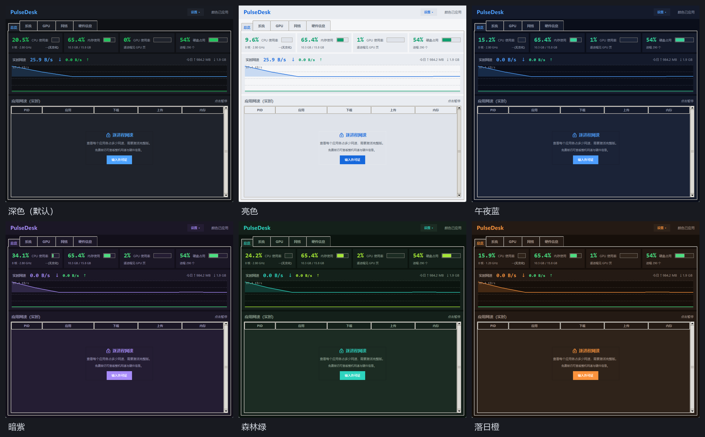
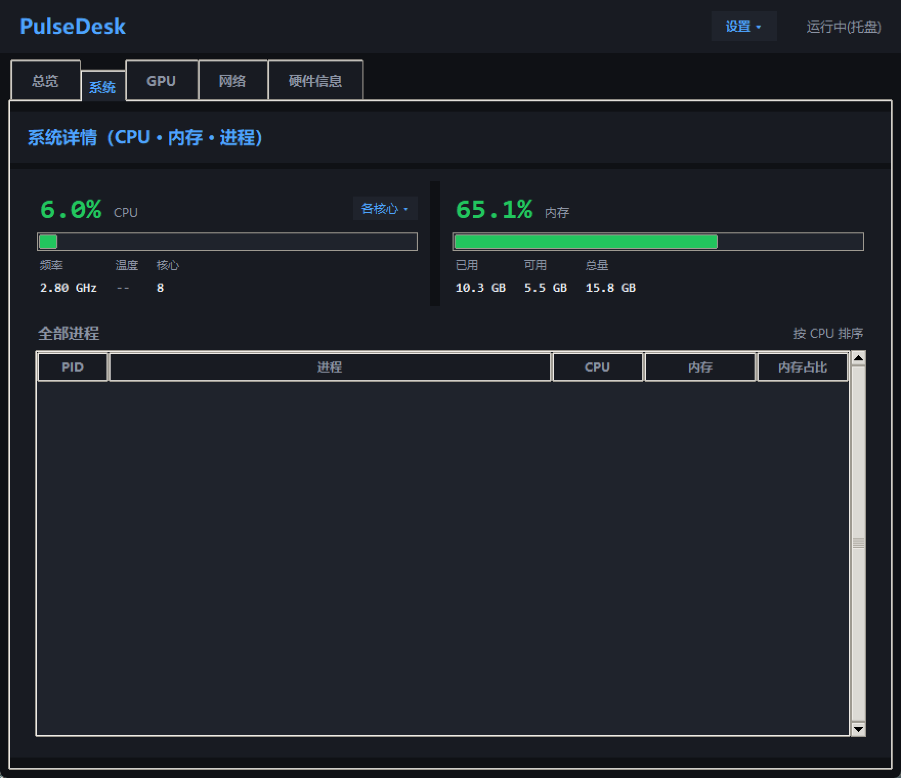
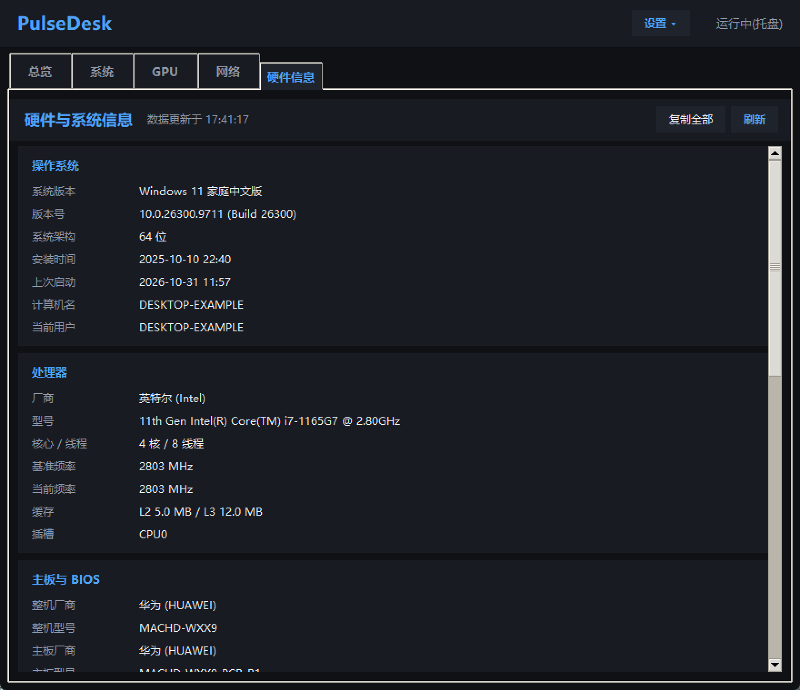
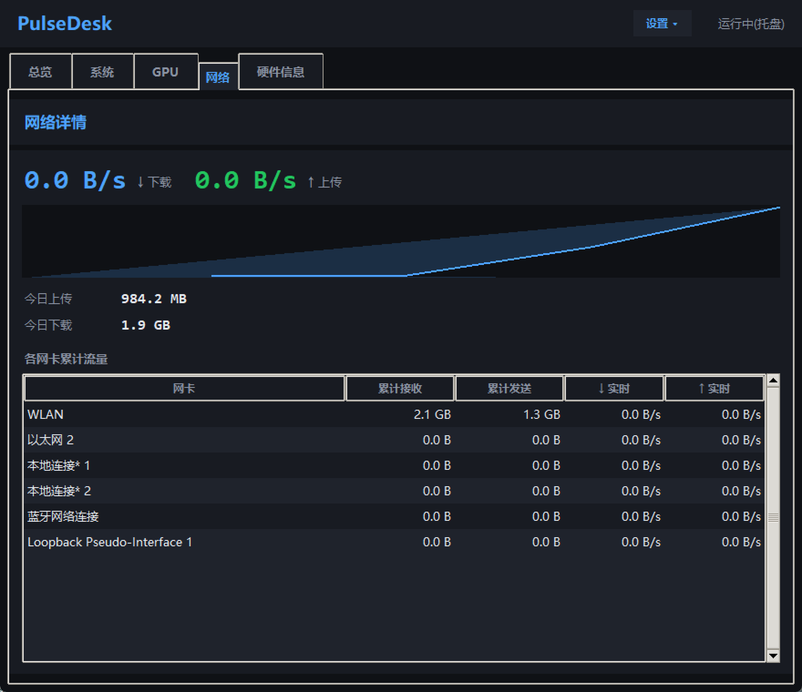

# PulseDesk 脉动桌面

一款 Windows 桌面系统监控工具。实时查看网速、CPU、内存、GPU，**以及每个软件各占多少网速**（完整版）。

解压即用，无需安装 —— 不用装 Python，不用装 VC++ 运行库，不写注册表 Run 项。



| 主界面 | 硬件信息页 |
|---|---|
|  |  |

| 网络页 |
|---|
|  |


---

## 下载

到 [Releases](../../releases/latest) 页面下载 `PulseDeskFree-win64.zip`，解压后双击里面的 `PulseDeskFree.exe`。

```
压缩包大小：约 16.7 MB
解压后：PulseDeskFree.exe（3.2 MB）+ _internal/ 依赖目录
SHA256：见 Release 页面的 SHA256SUMS.txt
```

> **为什么是 zip 而不是单个 exe**
>
> 早期版本用单文件（onefile）打包，但「单个 exe 自解压 + fork 子进程」
> 的行为特征会被 Windows Defender 的机器学习模型误判为木马
> （`Trojan:Win32/Bearfoos.A!ml`）并**直接隔离删除文件**。
> 改成目录形式（onedir）后不再有自解压和 fork，误报大幅下降。
>
> 代价是要解压。**解压后 `PulseDeskFree.exe` 和 `_internal` 目录必须放在一起**，
> 只拷 exe 出去是跑不起来的。

> **首次运行可能被 Windows 拦一下**
>
> 因为个人项目没有买代码签名证书（¥1200/年），SmartScreen 可能提示
> 「Windows 已保护你的电脑」。点「更多信息」→「仍要运行」即可。
>
> 如果 Defender 仍然隔离了文件（误报），把解压目录加进
> 「Windows 安全中心 → 病毒和威胁防护 → 排除项」即可。
>
> 也可以先核对 SHA256SUMS.txt，确认文件没被篡改。

---

## 功能

### 网速

- ⬆️⬇️ **整机实时上传 / 下载速度**，带历史曲线
- 📅 **今日累计流量**，跨天自动清零
- 🔌 **多网卡选择** —— 自动过滤回环 / 蓝牙 / 未连接的虚拟网卡

### 硬件

- 🖥️ **CPU** 使用率 + 实时频率（GHz）
- 🧠 **内存** 使用率 + 已用 / 总量
- 🎮 **GPU** 利用率（Intel 核显 / NVIDIA / AMD 都能读）
- 💾 **硬盘** 各盘使用率
- 🌡️ **CPU 温度**（完整版功能；免费版不显示此项，也不会催你安装守护进程）

### 硬件信息页

独立的「硬件信息」分页，分类展示：

操作系统 / 处理器 / 主板与 BIOS / 内存（含条数与频率）/ 显卡 / 存储（含分区用量）/ 网络

**每类都显示生产厂家**，中英文对照，例如「英特尔 (Intel)」「华为 (HUAWEI)」「美光 (Micron)」。
一键复制全部信息。

### 界面

- 🎨 **6 套皮肤**：深色 / 亮色 / 午夜蓝 / 暗紫 / 森林绿 / 落日橙
- 🖌️ **12 项颜色自定义** + 可以把**自己的照片设成背景**
- 🌐 **8 种界面语言**：简体中文 / English / 日本語 / 한국어 / Deutsch / Français / Español / Русский
  默认跟随系统语言，也可手动切换，切换后立即生效
- 🪟 **悬浮窗**：置顶小窗，显示项逐项开关，透明度可调，
  可拖动，支持**鼠标穿透**（穿透后右键菜单需先在设置里关掉）
- 🖱️ **系统托盘**：点 × 隐藏到托盘，托盘菜单可快速开关各项

### 其他

- ⚙️ **设置中心**：刷新间隔、开机自启、启动隐藏、显示项、网速单位、告警阈值，改完立即生效
- 🔔 **告警**：内存占用过高时弹窗提醒（温度告警属完整版）
- 📄 **开源许可声明页**：18 个第三方组件，合规可商用
- 🔒 **不联网**：程序里没有任何网络请求代码，不收集任何数据

---

## 免费版 / 完整版

| 功能 | 免费版 | 完整版 |
|---|---|---|
| 整机网速 + 曲线 + 今日流量 | ✅ | ✅ |
| CPU / 内存 / GPU / 硬盘使用率 | ✅ | ✅ |
| 硬件信息页 | ✅ | ✅ |
| 6 皮肤 / 12 色 / 照片壁纸 / 8 语言 | ✅ | ✅ |
| 悬浮窗 / 托盘 / 开机自启 / 告警 | ✅ | ✅ |
| **CPU 温度**（真实读数） | — | ✅ |
| **逐进程网速**（哪个软件在偷跑流量） | — | ✅ |

免费版永久免费、无广告、无功能试用期。**只有上面两项锁定**，其余功能两版完全一致。

完整版 $9.99 一次性买断，**永久授权，不订阅**。

购买方式：在 [Issues](../../issues) 里新建一个 issue，标题写「购买完整版」，
我会在 24 小时内回复支付方式并把许可证发给你。
（走 issue 是为了留个记录，也方便你随时找回自己的许可证。）

> 为什么要走 issue 而不是放个购买按钮：这是个刚发布的个人项目，
> 我不想让你在一个不成熟的支付页上填卡号。issue 里直接对接，出问题能找到人。

---

## 系统要求

| 项目 | 要求 |
|---|---|
| 系统 | Windows 10 / 11（64 位） |
| 权限 | **普通用户即可运行** |
| 依赖 | 无。不需要 .NET、不需要 VC++ 运行库、不需要 Python |
| 空间 | 约 17 MB |

> Windows 7 无法运行（程序基于 Python 3.12 构建，最低要求 Win8.1）。
> 多显示器已做边界兼容，但开发机是单屏，未实测。

---

## 可选：两个增强功能

温度和逐进程网速需要安装两个后台守护进程（**计划任务**形式）。
完整版首次运行会自动询问，也可以在托盘菜单里随时安装 / 卸载。
免费版不提供这两项，因此不会弹任何安装提示。

| 功能 | 计划任务名 | 不装的后果 |
|---|---|---|
| CPU 温度 | `NetMonitorTempd` | 温度显示 `--` |
| 逐进程网速 | `NetMonitorNetd` | 应用网速列表全空 |

两个都装失败也不影响主程序 —— 其他功能照常工作。

**为什么拆成守护进程？**
读 CPU 温度要访问 MSR 寄存器，必须有管理员权限。如果把这段代码
放进主程序，整个程序都得提权运行。拆成计划任务后，主程序保持普通权限，
只在需要时跟守护进程通信。

---

## 常见问题

**Q：和 TrafficMonitor 有什么区别？**

TrafficMonitor 是很好的免费工具，功能更成熟（任务栏嵌入、插件系统、历史统计）。
PulseDesk 的定位不太一样：

- 有**硬件信息页**（主板、内存条频率、厂商识别）
- **8 种界面语言**（TrafficMonitor 主要是中文）
- **解压即用**，不需要额外的运行库
- 界面是深色仪表盘风格，悬浮窗支持鼠标穿透

功能上各有取舍，你可以两个都试试。

**Q：为什么不签名？**

个人开发者申请代码签名证书要 ¥1200/年（Certum），OV 证书还需要企业营业执照。
在没有收入之前这笔钱不好投。所以目前只能靠 SHA256 校验 + 手动放行。

**Q：杀软报毒怎么办？**

PyInstaller 打包的 exe 有时会被启发式引擎误报（因为自解压行为）。
这是行业普遍现象，不是程序有问题。可以：
1. 核对 SHA256 确认文件完整
2. 把文件加到杀软白名单
3. 在 [Issues](../../issues) 里反馈具体是哪个杀软，我帮你查

**Q：温度一直显示 `--`？**

免费版没有温度功能（这是完整版专有）。如果你买的是完整版还显示 `--`：

1. 温度守护进程没装 —— 托盘菜单里点「温度监控 → 安装」
2. 主板传感器不被支持（部分笔记本屏蔽了 MSR 访问）
3. 在虚拟机里运行（虚拟机通常不暴露温度传感器）

**Q：会收集我的数据吗？**

不会。程序**没有任何联网代码**，没有统计上报，没有崩溃上报，不写注册表
（除了开机自启那一项，你手动开启时才会写）。

配置文件在 `%APPDATA%\NetMonitor\config.json`，纯本地。
（目录名沿用了项目的早期内部代号，与程序名不一致，这是历史遗留，不影响使用。）

---

## 反馈

遇到 bug 或有功能建议，欢迎提 [Issue](../../issues)。

提之前请附上：
- 系统版本（`winver` 里能看到）
- 报错截图或文字
- 复现步骤

---

## 关于

个人项目。UI 用 Tkinter，硬件采集用 psutil + LibreHardwareMonitor，
逐进程网速用 C# 写的 ETW 守护进程。

用到的开源组件及其许可证，见程序内「设置 ▾ → 关于 → 开源许可」，
或 [THIRD-PARTY-NOTICES.md](THIRD-PARTY-NOTICES.md)。

程序本身免费使用，不限制商用。
